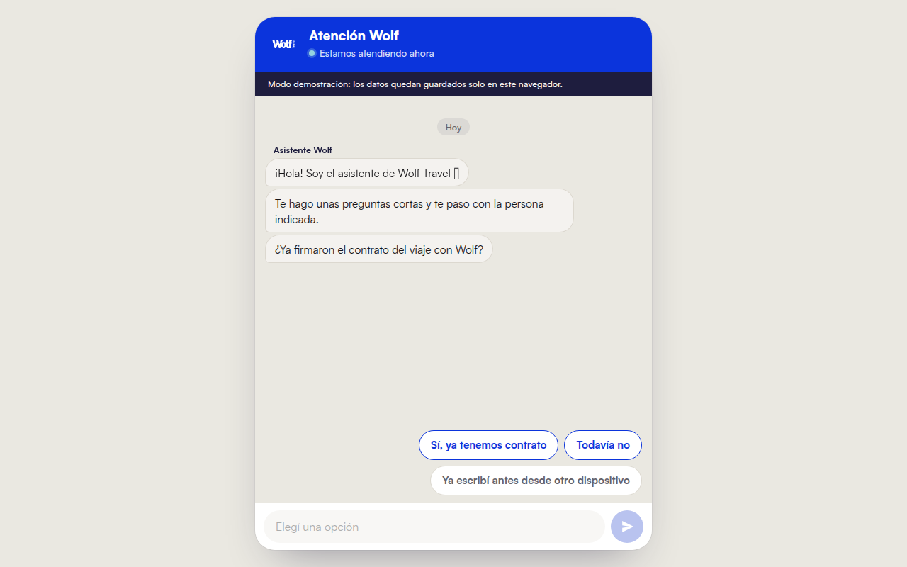
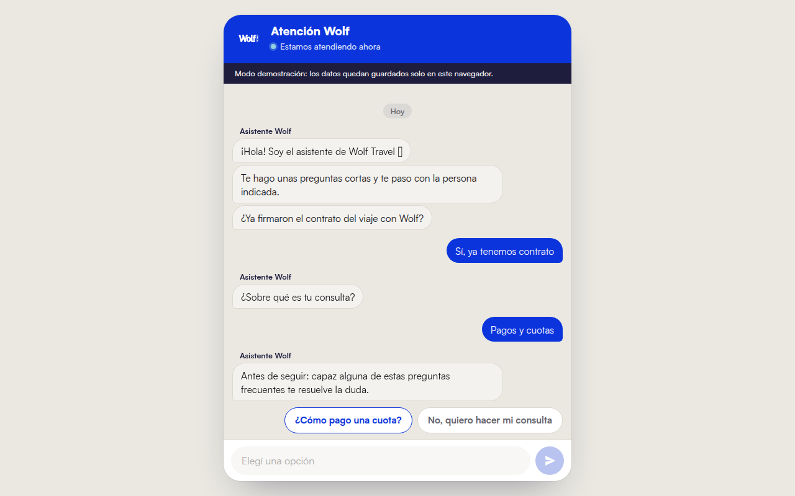
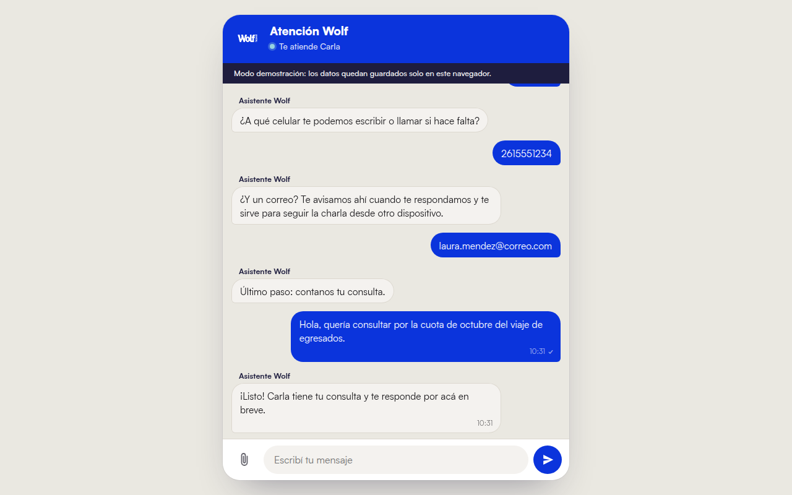
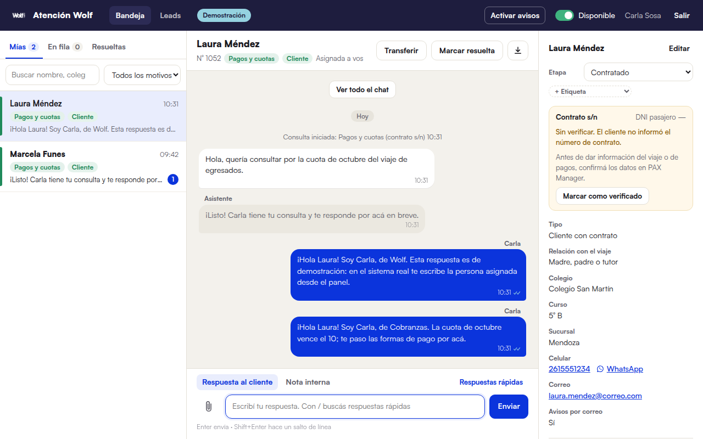
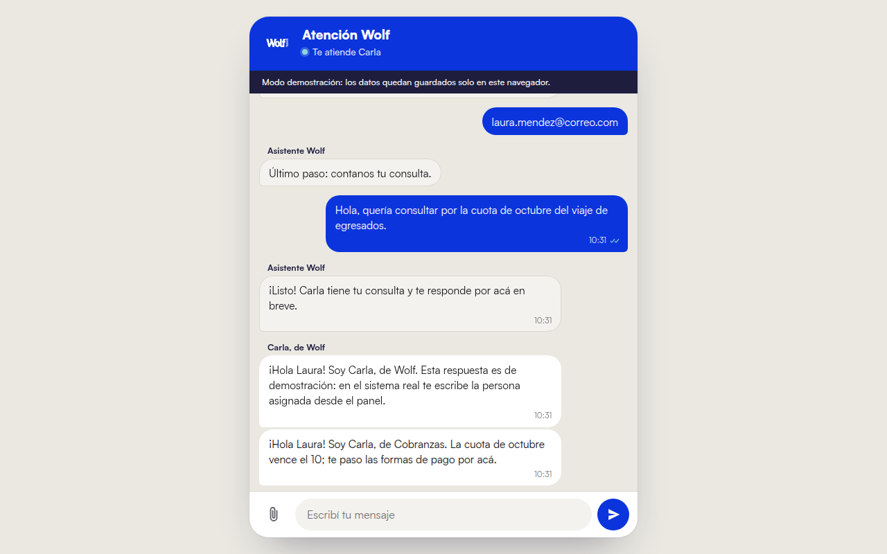
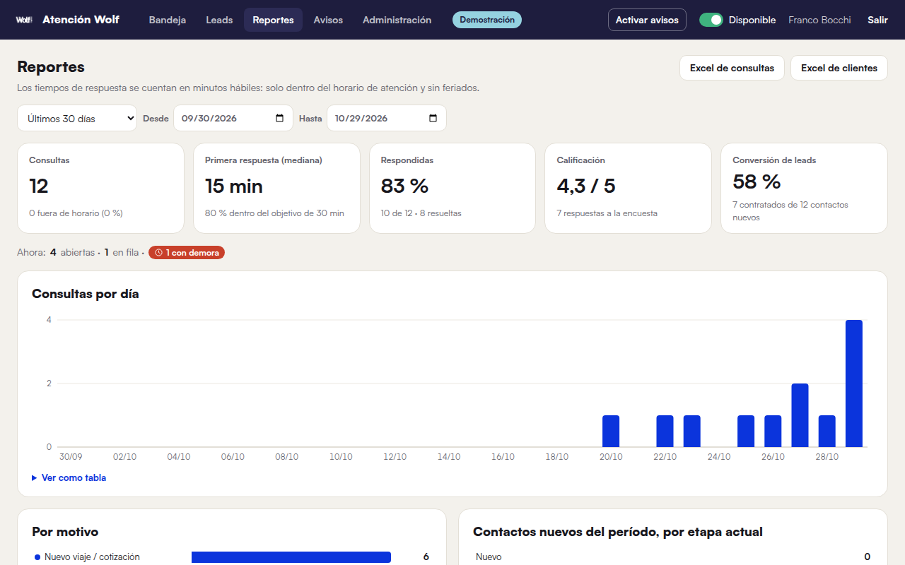
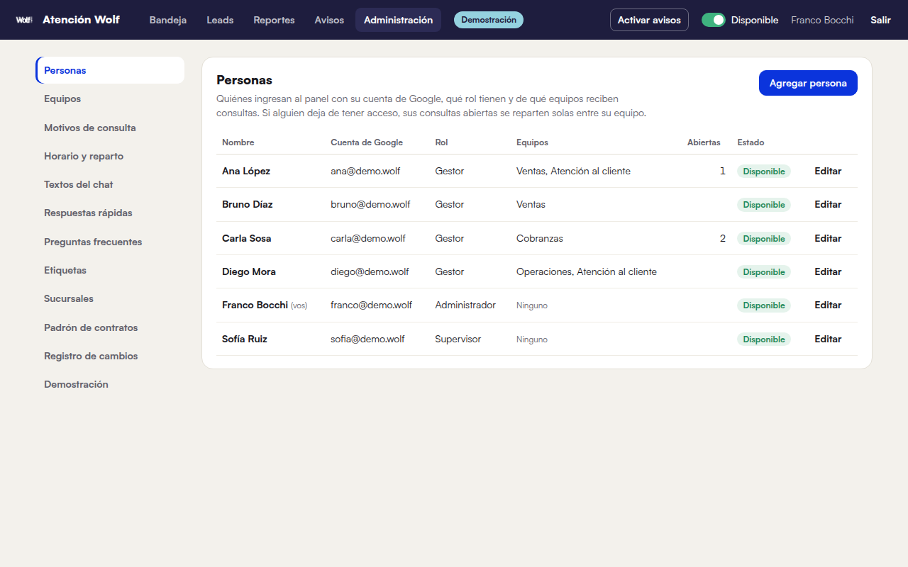

# Wolf Atención — chat de atención al cliente con panel en tiempo real

**Un chat propio que recibe, ordena y reparte las consultas de los clientes de una agencia de viajes — sin pagar por mensaje.**

Hecho para Wolf Travel (viajes de egresados y estudiantiles). El cliente escribe desde la web, un bot toma sus datos, y la consulta llega al gestor correcto, que responde desde un panel web en tiempo real, instalable en la computadora o el celular.



## El problema

Las consultas de pagos, documentación y reclamos llegaban por WhatsApp, mezcladas, sin dueño, sin horarios ni métricas. Nadie sabía cuánto se tardaba en responder ni qué consultas quedaban colgadas.

## La solución en 4 pasos

1. **El bot recibe al cliente.** Pregunta si ya tiene contrato, el motivo de la consulta y ofrece preguntas frecuentes antes de molestar a una persona.
2. **Reconoce el contrato.** Busca por número, código, sigla o colegio, y confirma los datos con el cliente.
3. **Asigna al gestor indicado** según el motivo y la carga de trabajo de cada uno.
4. **El gestor responde desde el panel** y el cliente lo ve al instante en su chat.

| El bot ofrece respuestas rápidas | Recoge los datos del viaje |
|---|---|
|  |  |

## El panel del equipo

Bandeja con consultas propias, en fila y resueltas. Ficha del cliente al costado, etapa comercial, etiquetas, notas internas, respuestas rápidas, transferencia entre gestores y adjuntos.



Y la respuesta le llega al cliente en el mismo momento:



## Reportes para decidir

Tiempo de primera respuesta (en minutos hábiles, solo dentro del horario y sin feriados), porcentaje de consultas respondidas, calificación de la encuesta, conversión de leads, consultas por día y por motivo. Con exportación a Excel.



## Administración sin tocar código

Equipos, motivos, sucursales, horarios, feriados, respuestas rápidas, preguntas frecuentes y textos del chat se editan desde el panel.



## Características

- **Sin costo por mensaje**: no usa la API de WhatsApp.
- **Tiempo real**: el cliente y el gestor ven los mensajes al instante.
- **Reparto automático** por motivo y por carga de trabajo, con reasignación si hay demora.
- **Catálogo de contratos** con búsqueda por número, código, sigla o colegio.
- **Notificaciones push** a los gestores y aviso por correo al cliente cuando le responden.
- **Avisos masivos** por correo a un colegio, curso o etapa.
- **Leads y etapas** comerciales, con etiquetas y encuesta de satisfacción.
- **Instalable** como app (PWA) en computadora y celular.
- **Seguridad**: ingreso con Google para el equipo, permisos por rol (administrador, supervisor, gestor), límites anti-abuso y política de privacidad.
- **Sin compilación**: HTML, CSS y JavaScript puros.

## Tecnología

Supabase (PostgreSQL, ingreso con Google, tiempo real, almacenamiento y Edge Functions), hosting estático, Web Push, JavaScript sin framework.

## Probarlo ahora

Funciona en **modo demostración**, sin configurar nada: los datos quedan en tu navegador y el panel trae usuarios de prueba.

```bash
cd web
python3 -m http.server 8000
```

- Chat del cliente: http://localhost:8000/chat/
- Panel del equipo: http://localhost:8000/panel/ (elegí un usuario de prueba)

Abrilos en pestañas distintas del mismo navegador, escribí como cliente y respondé como gestor.

> Esta es la versión de demostración del proyecto. El sistema real usa una base de datos de producción y datos de clientes que no se publican.
